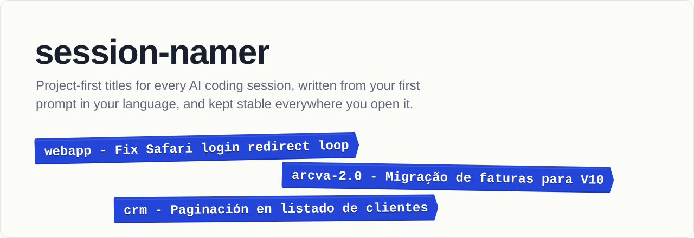
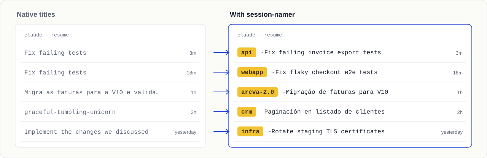
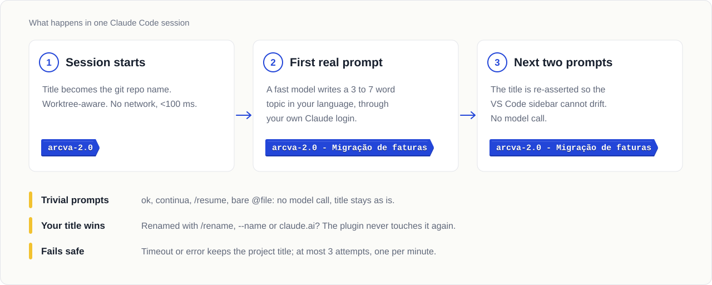
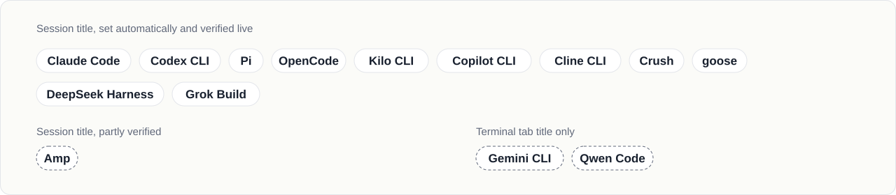

<picture>
  <source media="(max-width: 600px) and (prefers-color-scheme: dark)" srcset="docs/assets/hero-narrow-dark.svg">
  <source media="(max-width: 600px)" srcset="docs/assets/hero-narrow-light.svg">
  <source media="(prefers-color-scheme: dark)" srcset="docs/assets/hero-dark.svg">
  
</picture>

<p align="center">
  <a href="https://github.com/brunobola-portfolio/claude-session-namer/actions/workflows/ci.yml"></a>
  <a href="LICENSE"></a>
  <a href="docs/harnesses.md"></a>
  
  
</p>

**session-namer** gives every AI coding session a title that says which
project it belongs to and what it is about: `webapp - Fix Safari login
redirect loop`. It writes the title from your first real prompt, in the
language you wrote it, and keeps it stable in the terminal, the session
picker, VS Code and your phone. It works in Claude Code and thirteen other
coding agents.

## Install

**Claude Code** (inside a session):

```
/plugin marketplace add brunobola-portfolio/claude-session-namer
/plugin install session-namer@claude-session-namer
```

**Any supported agent**, Claude Code included, from a terminal:

```bash
npx -y github:brunobola-portfolio/claude-session-namer#v1.2.0 install --detect --dry-run   # see what would change
npx -y github:brunobola-portfolio/claude-session-namer#v1.2.0 install --detect             # set up every agent found
```

`--detect` sets up every supported agent on your `PATH`; name them instead to
be selective (`install codex pi opencode`). Most agents need nothing more. A
few need a one-time step, which the installer prints: Codex CLI asks you to
trust the hooks in `/hooks`, and Copilot CLI needs `/experimental on`.
`status` shows what is installed and `uninstall` removes it. No API key, no
account, no daemon. Details per agent are in [docs/install.md](docs/install.md).

**Requirements:**

- Node.js 18 or newer.
- Claude Code 2.1.152 or newer, for the plugin.
- The `claude` CLI, logged in, writes the topic for most agents. Pi,
  OpenCode and Kilo CLI can use their own model instead (Codex CLI too, opt-in),
  and OpenCode, Crush and goose fall back to their own title when `claude` is
  missing.

**Check that it worked:** start a session and send a real message. Within a
few seconds the title reads `<repo> - <topic>`, in the terminal and in the
session list (`claude --resume`, `codex resume`, and so on). `status` and
`/session-name --doctor` show the details.

**Update:** `/plugin marketplace update claude-session-namer` in Claude Code;
for other agents, run the same `install` command with the newer version tag.

## The problem it solves

Run a few agents across a few repositories and the session list stops
helping. Claude Code already writes a short title for an unnamed session, but
it is a summary of your first prompt with no project in it, so two
"Fix failing tests" sessions from different repositories look the same.
In Remote Control the title follows your latest message, so it changes under
you. Every other agent titles sessions its own way, if at all, so the same
work looks different in every tool.

<picture>
  <source media="(max-width: 600px) and (prefers-color-scheme: dark)" srcset="docs/assets/before-after-narrow-dark.svg">
  <source media="(max-width: 600px)" srcset="docs/assets/before-after-narrow-light.svg">
  <source media="(prefers-color-scheme: dark)" srcset="docs/assets/before-after-dark.svg">
  
</picture>

With session-namer the project comes first, the topic is specific, and the
title does not move once it is set. You find the right session without
opening any of them.

## What you get

| | Native titles (Claude Code) | session-namer |
| :-- | :-- | :-- |
| Project in the title | No | Yes, from the git repository, shared by all worktrees |
| Topic | Summary of the first prompt | 3 to 7 words, in the language of your prompt |
| `ok`, `continue`, `/resume` as the first message | Based on the first prompt, whatever it is | Ignored, no model call; the next real prompt names the session |
| Stable in Remote Control | Follows your latest message | Fixed once set, like `/rename` |
| VS Code sidebar | Its own generated title | Set again on the next two prompts, so it does not drift |
| Your own `/rename` or `--name` | Respected | Respected, detected even mid-session |
| Per-repository project name | No | `.session-namer.json` |
| Diagnostics | No | `/session-name --doctor` with a timed dry run |
| Other agents | Claude Code only | 13 more, see below |

## How it works

<picture>
  <source media="(max-width: 600px) and (prefers-color-scheme: dark)" srcset="docs/assets/flow-narrow-dark.svg">
  <source media="(max-width: 600px)" srcset="docs/assets/flow-narrow-light.svg">
  <source media="(prefers-color-scheme: dark)" srcset="docs/assets/flow-dark.svg">
  
</picture>

The title is set through each agent's own supported mechanism (in Claude
Code, the documented `sessionTitle` hook output), so it shows up everywhere
that agent shows titles. The topic comes from one call to a fast model
through **a login you already have**: `claude -p` with Haiku by default, about
USD 0.004 per session, or the agent's own model where the adapter supports it.
If a call fails, it retries at most twice more. The prompt is truncated and
wrapped so that instructions inside it are summarised, never followed.

In Claude Code the first prompt waits a few seconds while the topic is
written, and Claude Code shows "Naming this session" meanwhile. Every later
prompt costs under 100 ms. The design, state machine and trade-offs are in
[docs/architecture.md](docs/architecture.md).

## Works with

<picture>
  <source media="(max-width: 600px) and (prefers-color-scheme: dark)" srcset="docs/assets/harnesses-narrow-dark.svg">
  <source media="(max-width: 600px)" srcset="docs/assets/harnesses-narrow-light.svg">
  <source media="(prefers-color-scheme: dark)" srcset="docs/assets/harnesses-dark.svg">
  
</picture>

Claude Code is **stable**. The other adapters are **beta**: each was
installed and tested live against a named version, and depends on agent APIs
that are still young. Gemini CLI and Qwen Code have no way to name a session,
so the title goes to the terminal tab instead of into their private files.
Factory Droid and Cursor CLI were examined too and have no safe mechanism
yet. The full matrix, with versions, mechanisms and caveats, is in
[docs/harnesses.md](docs/harnesses.md).

## The `/session-name` command (Claude Code)

| Command | Effect |
| :-- | :-- |
| `/session-name Name I want` | Renames to `<project> - Name I want` now and locks it |
| `/session-name` or `/session-name --regenerate` | Back to the project name; the next message writes a fresh topic |
| `/session-name --remote` | How to continue this session from your phone or browser |
| `/session-name --doctor` | Node, `claude` path and version, options, recent log lines and a timed dry run |

## Configuration

Everything is optional. In Claude Code, `/plugin configure
session-namer@claude-session-namer` shows these:

| Option | Default | Meaning |
| :-- | :-- | :-- |
| `model` | `haiku` | Model alias or id that writes the topic |
| `separator` | ` - ` | Text between project and topic |
| `max_words` | `7` | Most words in a topic (3 to 12); longer topics are cut |
| `timeout_ms` | `20000` | How long to wait for the topic (1 to 22 s) before keeping the project title |
| `project_source` | `git` | `git` uses the repository name, shared by worktrees; `cwd` uses the folder name |
| `name_headless` | `false` | Also name `claude -p` sessions |
| `enabled` | `true` | Master switch |

**Environment variables** work in every agent and override the options:
`SESSION_NAMER_ENABLED`, `CLAUDE_SESSION_NAMER=off`, `SESSION_NAMER_MODEL`,
`SESSION_NAMER_TIMEOUT_MS`, `SESSION_NAMER_MAX_WORDS`,
`SESSION_NAMER_SEPARATOR`, `SESSION_NAMER_PROJECT_SOURCE`,
`SESSION_NAMER_NAME_HEADLESS`, `SESSION_NAMER_CLAUDE_PATH` and
`SESSION_NAMER_BARE=1` (faster `claude --bare`, API-key logins only).

**Per repository**, a `.session-namer.json` at the root can set a friendlier
project name or turn naming off for that repository. Only these two keys are
read, and the file never runs code.

```json
{ "project": "ARCVA", "enabled": true }
```

## Remote Control

Type `/rc` in a session to continue it from [claude.ai/code](https://claude.ai/code)
or the Claude mobile app, where it appears under its session-namer title. To
connect every session, set `"remoteControlAtStartup": true` in
`~/.claude/settings.json`. From a terminal, start with `claude --rc` and no
name: a name passed to `--remote-control` takes priority over any title.

## Privacy and safety

- One model call per session (up to three if calls fail), through a login you
  already use. No telemetry, no third-party service, no dependencies.
- The headless `claude -p` call runs with no settings, no MCP servers, no
  tools and no slash commands, so it cannot run anything or trigger other
  hooks.
- Titles are stripped of control characters, escape sequences, invisible and
  bidi characters, and rejected if the model answered instead of titling.
- Every hook exits 0 on every path. If anything fails, the session keeps its
  project title and works normally.
- The installer backs up every config file it edits and `uninstall` restores
  it. State and logs live under `$CLAUDE_CONFIG_DIR/session-namer/` (default
  `~/.claude/session-namer/`) and each agent's own config folder.

More detail, and how to report a vulnerability, in [SECURITY.md](SECURITY.md).

## Troubleshooting

Run `/session-name --doctor` in Claude Code, or
`npx -y github:brunobola-portfolio/claude-session-namer#v1.2.0 status` for any agent.

| Symptom | Likely cause | Fix |
| :-- | :-- | :-- |
| Project name but never a topic | `claude` not found, or the call fails | Doctor shows the path and a dry run; set `SESSION_NAMER_CLAUDE_PATH` |
| Dry run says `Not logged in` | `SESSION_NAMER_BARE=1` with an OAuth login | Unset it; bare mode needs an API key |
| Nothing happens | Node.js not on `PATH`, or `enabled=false` | Install Node 18+, check the options |
| Topic in the wrong language | The model slipped | `/session-name <topic>` or `/session-name --regenerate` |
| VS Code sidebar shows an older title | The extension caches its list | Reopen the session; `claude --resume` shows the current title |

The log is `~/.claude/session-namer/log.txt`, rotated at 512 KB. Each
adapter's README names its own log and checks.

## Uninstall

```
/plugin uninstall session-namer@claude-session-namer
/plugin marketplace remove claude-session-namer
```

or, for any agent, `npx -y github:brunobola-portfolio/claude-session-namer#v1.2.0
uninstall --all`. Titles already set stay as they are.

## Other approaches

Other projects cover parts of the same problem:
[claude-rename](https://github.com/sathwick-p/claude-rename) writes titles
into transcripts after the fact, [rename](https://github.com/study8677/rename)
runs a daemon that re-titles idle sessions across several agents,
[agent-session-titles](https://github.com/panda-z519/agent-session-titles)
keeps a live status in the title, and
[which-claude-code](https://github.com/jbarbier/which-claude-code) puts a topic
in the status line. session-namer's angle is a stable, project-first title set
live through each agent's supported mechanism, with no daemon.

## Contributing

Issues and pull requests are welcome; start with
[CONTRIBUTING.md](CONTRIBUTING.md). `npm test` runs the whole suite with no
install step.

## Support the project

If session-namer saves you a few minutes a week, you can buy BolaLabs a coffee.

<p>
  <a href="https://ko-fi.com/brunobola"></a>
  <a href="https://buymeacoffee.com/brunobola"></a>
</p>

## License

[MIT](LICENSE), © 2026 BolaLabs.
