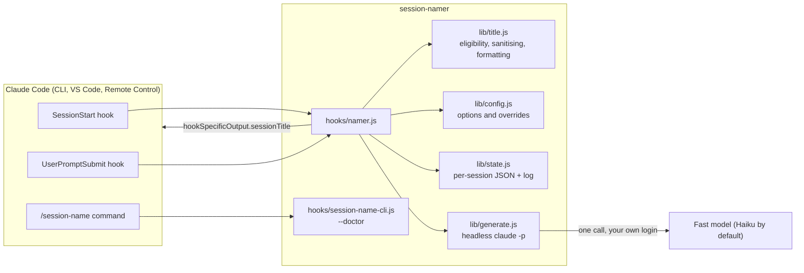
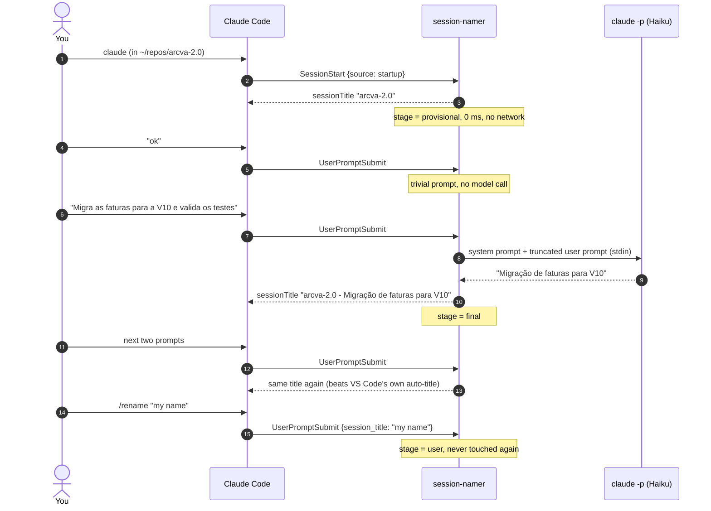
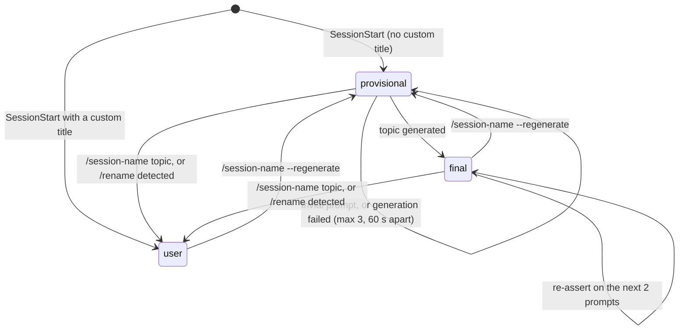

# Architecture

session-namer is two Claude Code hooks, one Node script and four small
modules. No dependencies, no daemon, no network calls of its own. This page
explains what runs when, what state is kept, and why each design decision was
made.

## Components

`namer.js` is the only entry point Claude Code runs. It reads the hook JSON
from stdin, decides, and prints either nothing or a single
`{"hookSpecificOutput":{"sessionTitle": ...}}` object. It exits 0 on every
path, including crashes, so a bug can never block a prompt.

## One session, step by step

## State machine

Every session has one small JSON file under
`$CLAUDE_CONFIG_DIR/session-namer/` (default `~/.claude/session-namer/`).

| Stage | Meaning | What the hook does |
| :-- | :-- | :-- |
| `provisional` | Title is the project name; no topic yet | Tries to generate on the next eligible prompt |
| `final` | Title is `<project> - <topic>` | Re-emits it on the next two prompts, then stays silent |
| `user` | You chose the title | Nothing, ever, until `/session-name --regenerate` |

Old state files are pruned after 30 days. The log (`log.txt`) rotates at 512 KB.

## Decisions and why

**The title comes from the hook, not from editing transcripts.** Claude Code
documents `sessionTitle` on both SessionStart and UserPromptSubmit (on
SessionStart, "with the same effect as `/rename`"). That makes the title live in every surface at once (the
terminal, `claude --resume`, the VS Code panel, claude.ai/code and the mobile
app) without touching any file Claude Code owns.

**Generation uses your own `claude` CLI.** No API key to configure, no
third-party service. The child process runs in lean mode: no settings sources
(so no hooks or plugins load and nothing can recurse), no MCP servers, no
tools, no slash commands, no session persistence, one turn. `--bare` would be
faster but skips the keychain, so it only works with API keys; it is opt-in
via `SESSION_NAMER_BARE=1`.

**The executable is found in a fixed order.** `SESSION_NAMER_CLAUDE_PATH`,
then `CLAUDE_CODE_EXECPATH` (exported by Claude Code to hooks, so the same
version that runs the session writes the title), then `PATH` and well-known
install folders. On Windows the npm `claude.cmd` shim is bypassed for the real
`claude.exe` beside it, because cmd.exe drops empty arguments such as
`--setting-sources ""`.

**Trivial prompts never cost a model call.** `ok`, `continua`, slash
commands, bare `@file` references and pasted-text markers are filtered by
`isEligiblePrompt` before anything is spawned. Huge prompts are cut to their
first 1 500 and last 300 characters.

**The model's answer is not trusted.** `sanitizeTopic` strips ANSI escapes,
control characters, emoji, quotes and `Title:` style prefixes, then rejects
anything shorter than 2 or longer than 12 words. A rejected answer counts as a
failed attempt and the project-only title stays.

**Re-assertion happens on prompts, not on Stop.** The VS Code extension can
replace the title once with its own generated one. Re-emitting the final
title on the next two prompts wins that race without running a hook at the end
of every turn.

**User titles are detected, not guessed.** Both hooks receive
`session_title` when the session has a custom title. If it differs from the
last title the plugin set, the user renamed the session, and the plugin steps
aside for good.

**Headless sessions are skipped.** `claude -p` runs (detected through
`CLAUDE_CODE_ENTRYPOINT=sdk-cli`) are left alone unless `name_headless` is on,
so scripts and CI never pay for a title nobody will read.

## Cost and latency

| Moment | Latency | Cost |
| :-- | :-- | :-- |
| SessionStart | under 100 ms (two quick `git rev-parse` calls) | none |
| First eligible prompt | 5 to 15 s, mostly Claude Code's own startup; Claude Code shows "Naming this session" meanwhile | about USD 0.004 with Haiku |
| Every other prompt | under 100 ms | none |

The first-prompt wait is the one trade-off of setting the title live from a
hook: `UserPromptSubmit` hooks run before the prompt is sent, and async hooks
cannot set a title. If the wait matters more to you than the title, set
`timeout_ms` lower; the plugin gives up cleanly and keeps the project title.
